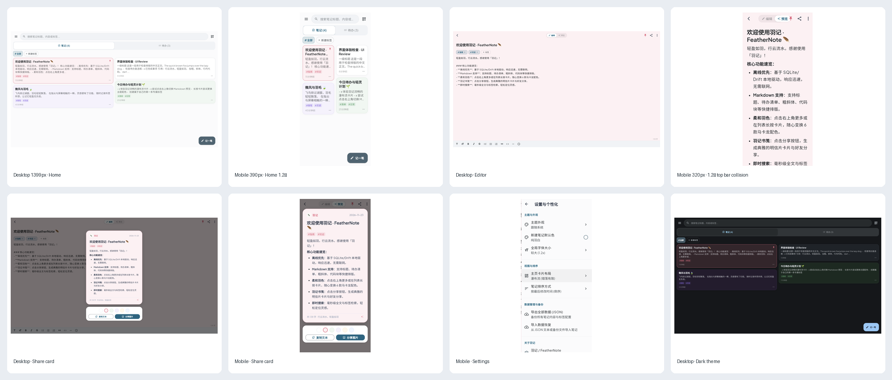
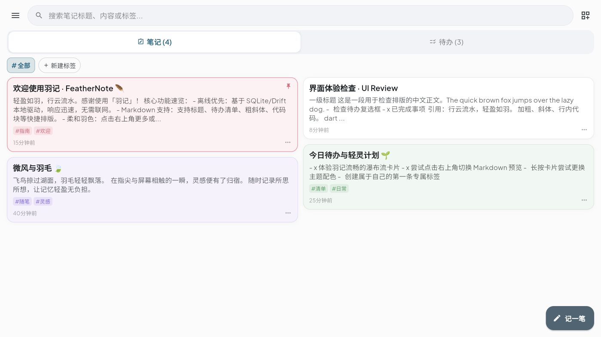
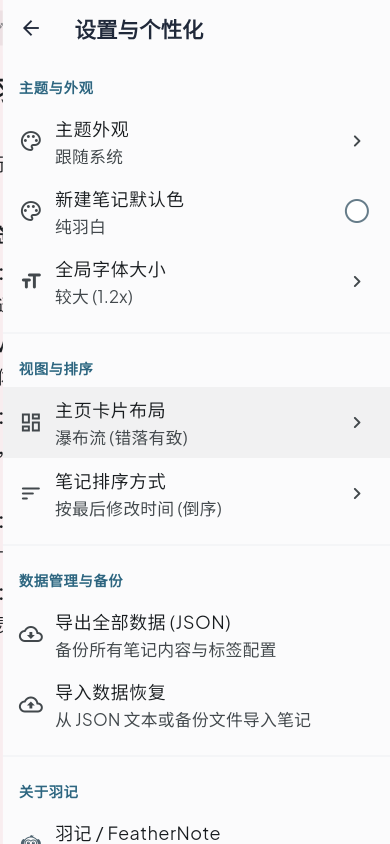
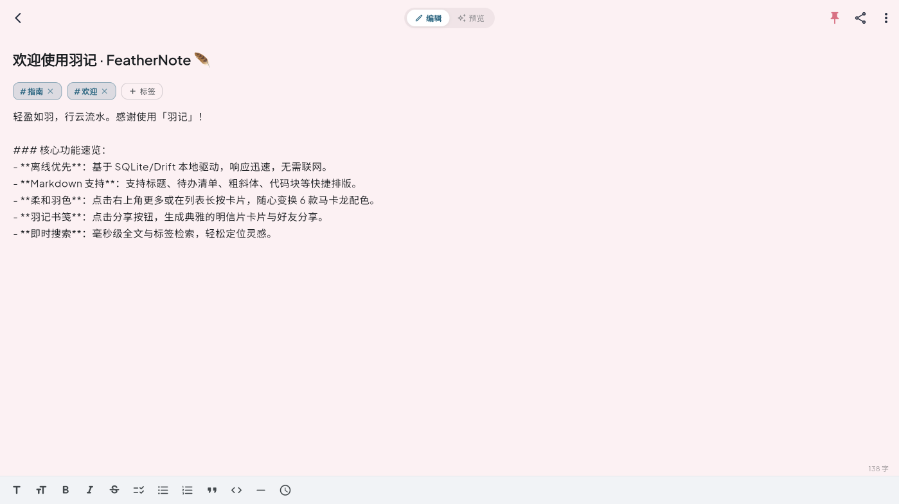
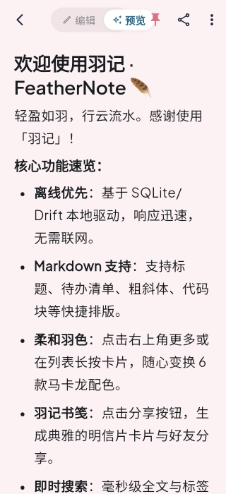

# 羽记 FeatherNote · UI/UX 全面审查

- 日期：2026-11-23
- 构建：Flutter Web Release
- 视口：桌面 1399×785（DPR 2），移动 390×844；补充 320×700 + 1.2× 字号
- 检查范围：笔记 / 待办 / 搜索 / 编辑 / 预览 / 归档箱 / 废纸篓 / 设置 / 侧边栏 / 主题、字体、配色、分享、信息、标签等弹窗；亮色与暗色；键盘与 Flutter Semantics 无障碍树
- 本报告只做审查，没有修改应用代码



## 结论

视觉语言是统一的：羽色体系、柔和底色、16–20px 圆角、Plus Jakarta Sans、Material 3 的层级都很完整，390px 移动端的笔记与待办首页已经相当顺手。

真正的问题集中在四处：

1. **桌面/平板没有响应式设计**，所有核心页面把 1399px 宽度直接铺满，阅读行长和卡片尺寸失控。
2. **可访问性基础薄弱**：文本输入没有可读名称、多个关键按钮只有 14–18px 可点区、系统字号被覆盖、框架文案仍是英文。
3. **小字号颜色对比不足**：卡片标签 10px、日期 10.5px，日期对比度约 2.8:1，标签多数低于 4.5:1。
4. **“数据与备份”闭环不完整**：导出只写剪贴板、导入只收粘贴文本，却宣称支持文件；标签颜色还会丢失。

未发现崩溃或阻断级 P0。按“影响主要任务”的程度，建议先修 P1，再做 P2 打磨。

## 优先级总览

| 级别 | 问题 | 用户感受 |
| --- | --- | --- |
| P1 | 桌面固定两列、全宽设置/编辑器 | 桌面像被放大的手机版；读长文很累 |
| P1 | 文本输入/图标按钮无可读标签，可点区过小 | 屏幕阅读器与触屏用户难以操作 |
| P1 | 系统字号被覆盖、框架文案为英文 | 系统大字号无效；中文界面中出现 Back / Dismiss |
| P1 | 10–10.5px 标签/日期对比不足 | 信息看不清，尤其暗色与樱/琥珀色 |
| P1 | 卡片摘要保留 Markdown 符号 | `- x`、`dart` 等噪声让卡片像未完成 |
| P1 | 备份导出/导入与描述不一致 | 用户以为备份了文件，实际只得到剪贴板文本 |
| P2 | 首次搜索 2–4 秒无有效进度 | 像卡死；第一次搜索体验差 |
| P2 | 320px + 1.2× 顶栏重叠 | 小屏/大字号下按钮叠在一起 |
| P2 | 归档卡片点击先弹操作单 | 与主页/搜索的“点开即读”不一致 |
| P2 | 清空已完成无确认/撤销 | 误触后没有应用内撤销 |
| P2 | 版本 1.0.0 / 1.0.1 不一致 | 降低发布可信度 |
| P3 | 标签 `# 指南` 与 `#指南` 不一致 | 细节不齐 |
| P3 | 分享卡长标题产生孤立 emoji | 导出图不够精致 |
| P3 | 空状态 4 秒浮动动画、无 reduced-motion | 动效偏好被忽略 |

---

## 1. 桌面 / 平板适配（P1）

### 1.1 首页固定两列

`lib/features/notes/presentation/screens/note_list_screen.dart:400-462` 中，瀑布流、网格、列表三种模式都写死为 `crossAxisCount: 2`：

- 1399px 视口下每张卡片约 680px 宽，标题只有 15px、正文 13px，留白和字号比例失衡；
- 只排两列，空间利用率低；条目为奇数时最后一行会留下半屏空白；
- 列表模式虽然是一列，但同样铺满 1399px。



### 1.2 搜索 / 归档 / 废纸篓同样固定两列

- `lib/features/notes/presentation/screens/note_search_screen.dart:101-105`
- `lib/features/archive_trash/presentation/screens/archive_screen.dart:34-48`
- `lib/features/archive_trash/presentation/screens/trash_screen.dart:45-58`

桌面端没有结果数量、没有内容宽度约束，搜索结果也仍是 680px 大卡。

### 1.3 设置页全宽

`lib/features/settings/presentation/screens/settings_screen.dart:34-155` 是普通的全宽 `ListView`。桌面端每行从最左延伸到最右，箭头落在 x≈1358；用户需要在 1400px 宽度两端来回扫视。



### 1.4 编辑器与预览没有阅读宽度

`lib/features/notes/presentation/screens/note_edit_screen.dart:382-475` 的编辑区只有 `padding: 20,12,20,120`，标题和正文实际宽度约 1359px；预览区 `:493-518` 同样是全宽。15.5px 字号下，中文约 87 字/行、英文约 170 字符/行，远超舒适阅读区间（中文约 30–40 字/行）。



预览模式也没有利用桌面空间做左右对照，只是在“编辑 / 预览”之间来回切换。

### 建议

- 引入统一的 `ResponsiveContent` / `PageFrame`，内容最大宽度 1120px，阅读类内容（设置、编辑器）最大 720–760px。
- 桌面断点建议：
  - `< 600px`：两列（当前移动端体验保留）；
  - `600–1024px`：2–3 列，内容最大 960px；
  - `> 1024px`：按“最大卡片宽度 280–320px”计算列数，而不是固定列数；首页内容居中。
- 编辑器在 `>= 1024px` 时改为左右分栏（左编辑、右预览），或至少提供“并排预览”开关。
- 设置页最大宽度 760px；可进一步做左侧分组导航 + 右侧设置项。
- 顶部 Tab 胶囊不要拉满 1399px，限制在 420–520px 并居中。

---

## 2. 可访问性（P1）

### 2.1 文本输入在 Web 语义中没有名称

在 Web 构建的编辑模式下，本次抓取的 Flutter Semantics 树中没有出现 `role=textbox` 节点；真实 DOM 的 `<input>` / `<textarea>`（x20,y68 / x20,y172）也没有 `aria-label`。placeholder 只存在于隐藏字段，输入后即消失，无法作为可靠名称。

**影响**：屏幕阅读器无法区分“标题”和“正文”，语音输入用户也无法按名称定位输入框。

**建议**：为两个 `TextField` 显式提供语义标签（例如外层 `Semantics(label: '笔记标题', textField: true)`），并确保标签在输入后仍然保留。

### 2.2 多个关键按钮低于最小可点区

| 控件 | 实际尺寸 | 位置 |
| --- | --- | --- |
| 卡片“更多” | 18×18 | `note_card.dart:147-154` |
| 搜索清除 | 18×18 | `feather_search_bar.dart:90-101` |
| 标签删除 | 14×14 | `feather_tag_chip.dart:66-74` |
| 待办勾选 | 38×32 | `todo_list_view.dart:347-365` |
| 待办删除 | 32×32 | `todo_list_view.dart:412-427` |
| 配色圆点（编辑） | 38×38 | `feather_color_picker.dart:30-62` |
| 配色圆点（分享） | 26×26 | `note_card_share_dialog.dart:319-340` |
| 分享操作按钮 | 169×32 | `note_card_share_dialog.dart:345-392` |
| 编辑器工具栏 | 36×43 / 个 | `note_editor_toolbar.dart` |

Material 建议 48×48；这些控件应保留视觉尺寸，但用 `SizedBox` / `IconButton` 扩大语义与点击区域，至少 44×44。

### 2.3 控件缺少标签与状态

- 卡片“更多”没有 tooltip / `Semantics.label`；
- 待办 checkbox 没有“完成 / 未完成”标签；
- 颜色圆点只有视觉色块，屏幕阅读器听到的是无名称按钮；
- 编辑 / 预览 pill 是 `GestureDetector` + `AnimatedContainer`，没有 `Semantics(selected: ...)`，无法播报当前模式（`note_edit_screen.dart:311-362`）；
- 顶部返回按钮在编辑页没有 tooltip，语义标签为空（`:137-139`）；
- 进度条只有 `aria-label="50"`，没有“今日待办 2/4”这样的上下文；
- 卡片 `role=group` 的 aria-label 直接拼接整段原始摘要，冗长且包含 Markdown 符号。

建议统一加 `Semantics(button: true, label: '...', selected: ...)`；卡片用 `MergeSemantics`，把标题、摘要、标签、日期合并为一条可读描述，并把“更多”单独暴露为按钮。

### 2.4 自定义点击区不可键盘聚焦

`GestureDetector` 不是焦点节点，以下控件键盘用户无法到达：

- 卡片“更多”、标签删除、颜色圆点、分享色板、编辑/预览切换、归档/废纸篓操作项。

建议改用 `InkWell` / `IconButton` / `TextButton`，或至少加 `FocusableActionDetector` + 可见 focus ring。

### 2.5 系统字号被覆盖

`lib/app.dart:26-32`：

```dart
MediaQuery(
  data: MediaQuery.of(context).copyWith(
    textScaler: TextScaler.linear(fontScale),
  ),
  ...
)
```

这会**丢弃系统字号设置**。App 内只提供 0.9 / 1.0 / 1.1 / 1.2 四档，最大 1.2×，无法满足 WCAG 2.1 的 200% 文本缩放要求，也让 iOS/Android 的“大号字体”失效。

建议以系统 `textScaler.scale(1.0)` 为基准乘以应用字号，或直接使用系统 `textScaler`，将应用内选项改成一个乘数而不是替换值。

### 2.6 中文界面里的英文框架文案

`MaterialApp.router` 没有配置 `localizationsDelegates` / `supportedLocales`（`lib/app.dart:19-33`）。实际观察到：

- 弹窗遮罩语义：`Dismiss`
- 更多菜单：`Show menu`
- 返回按钮：`Back`
- 文本选择菜单的剪切/复制/粘贴也会是英文

这在一个全中文界面中非常突兀，也会让中文屏幕阅读器读英文。

建议加入 `flutter_localizations`，配置 `GlobalMaterialLocalizations.delegate`、`GlobalWidgetsLocalizations.delegate`、`GlobalCupertinoLocalizations.delegate`，并支持 `zh_CN`。

### 2.7 侧边栏选中态错误

`lib/features/notes/presentation/screens/note_list_screen.dart:570-579` 把“全部笔记”写死为 `selected: true`。即使用户当前在“待办”页，打开侧边栏仍然高亮“全部笔记”。应监听当前 tab，或在“待办清单”项上加选中态。

---

## 3. 字号、对比度与排版（P1）

### 3.1 卡片标签

`note_card.dart:113-130`：标签 10px、`accentColor` 文本、背景是 accent 12% 的浅色 tint。

按当前六个预设计算，亮色主题下多数标签对比度低于 4.5:1，樱、琥珀最低约 2.4–2.8:1；暗色下默认色约 3.4:1。10px 小字加低对比，在移动端已经很难读。

### 3.2 日期与状态

- 卡片日期 10.5px，`onSurface` 45% alpha（`note_card.dart:140-144`），亮色下约 **2.84:1**，暗色下约 **3.74:1**。
- 编辑器底部“138 字”11px，同样 45% alpha（`note_edit_screen.dart:693-717`），对比度也约 2.84:1。
- 已完成待办的文字 40% alpha（`todo_list_view.dart:376-379`），可读性更弱。

### 3.3 建议

- 正文/标签/日期最小 12px，日期 12px、标签 11–12px；不要用 10px 承载信息。
- 小字不要用 accent 本身，改为 `onSurfaceVariant` 70%–80%，或把 accent 压深到 4.5:1；accent 只用于边框、圆点和图标。
- 标签底色改为 8%–10% 或加边框，让文字有足够对比。
- 暗色主题单独跑一次对比度检查；现有默认色/薰衣草紫在暗色下也不足 4.5:1。

---

## 4. 卡片摘要的 Markdown 噪声（P1）

`lib/core/utils/text_utils.dart:114-136` 的清洗顺序有 bug：

```dart
_markdownHeadingsRegex  // #+\s*
_markdownFormattingRegex // [*_~`>\[\]\(\)]
_markdownCheckboxesRegex // [-*+]\s+\[[ xX]\]
```

格式化正则先删掉了 `[` 和 `]`，于是 `- [x] 体验...` 先变成 `- x 体验...`，checkbox 正则再也匹配不到；无序列表的 `-` 也保留下来。实际卡片出现：

- `- x 体验羽记流畅的瀑布流卡片`
- `- 离线优先: ...`
- 代码块的语言标记 `dart ...`

**建议**：先匹配并移除 checkbox（`- [ ]` / `- [x]`），再处理粗体、链接等符号；列表项转换为“·”或直接去符号；代码块只保留内容。为 `- [ ]`、`- [x]`、`### 标题`、围栏代码、链接补充单元测试。

---

## 5. 交互与反馈（P2）

### 5.1 首次搜索等待 2–4 秒且几乎没有反馈

实测：

- 移动端 390px：输入“羽”后约 **1.86s** 才出现结果；
- 桌面冷启动：曾出现 **约 4s** 的空白页 + 极小 spinner。

`note_search_screen.dart:77-99` 已有 stale-while-revalidate 和 spinner，但首次没有旧结果时只有居中的 2.5px 圆圈，视觉上接近“空白”。看起来是首次查询触发数据库 / FTS 冷启动。

建议：

- 搜索框下方立刻显示细进度条或 2–3 个 skeleton 卡片；
- 文案“正在搜索…”，并在完成后显示“找到 N 条”；
- 启动后预热数据库 / FTS（若代价可控），或把首次打开搜索页时的空查询也作为 warm-up。

### 5.2 320px + 1.2× 顶栏重叠

390px / 1.2× 时顶栏刚好放下；320px / 1.2× 时，编辑预览 pill（x76–218）与 pin 按钮（x200–240）重叠 18px。`AppBar` 用 `centerTitle: true` 放自定义 pill，左右两侧都是固定宽度按钮，没有断点降级。



建议 `< 360px` 时隐藏 pill 文案只留图标，或把 pin/share 收进更多菜单；也可以把 pill 改成两段纯图标。

### 5.3 归档箱点击语义不一致

主页和搜索是“点卡片 = 打开笔记”，归档箱却是“点卡片 = 弹出操作单”（`archive_screen.dart:34-48`），需要再点一次“查看与编辑”。建议点击直接打开笔记，操作单放到“更多”或长按；如果刻意保持管理态，至少在卡片上显示“管理”提示。

### 5.4 清空已完成没有确认或撤销

`todo_list_view.dart:244-265` 的“清空已完成”立即执行；`Dismissible` 删除待办也没有 `onUndo`（`:296-314`）。两者都会改写所属笔记内容，误触成本高。建议二次确认或 Snackbar 撤销。

### 5.5 删除笔记失败仍会退出编辑器

`note_edit_screen.dart:218-226`：

```dart
await runWithFeedback(context, notifier.deleteNote, ...);
if (context.mounted) context.pop();
```

`runWithFeedback` 捕获异常后只弹 Snackbar，返回 `void`（`app_feedback.dart:25-58`），调用方无法知道失败；删除失败也会退出编辑器，用户会以为已删除。

建议让 `runWithFeedback` 返回 `bool`，失败时不 pop；或改为直接 `try/catch`。

### 5.6 设置页“默认配色” trailing 圆点像未选中的 radio

设置页的默认颜色行只显示一个小圆点；纯白预设看起来是一个空心的未选 radio。底部弹窗里的 6 个圆点也没有颜色名称/选中勾（`settings_screen.dart:258-284`）。建议显示颜色名 + 选中勾，或至少加一个 `#` 色值/边框。

### 5.7 工具栏在移动端横向滚动，桌面端留白

`note_editor_toolbar.dart` 是 44px 高的横向 `ListView`，12 个 36×43 按钮：

- 390px 下后半段需要横滑，没有“还有更多”的渐隐提示；
- 1399px 下按钮只占左侧，右侧大片空白。

建议移动端分组为两行或“更多”菜单；桌面端居中或按功能分组，并显示快捷键。

---

## 6. 数据与备份闭环（P1）

### 6.1 导出只有剪贴板

`settings_screen.dart:332-371`：

- `repo.getAllNotes()` 取全部笔记；
- JSON 序列化后 `Clipboard.setData`；
- 成功弹窗说“复制到系统剪贴板，您可以粘贴保存到文件中”。

在 Web 上这会触发 Chrome 的剪贴板权限提示（本次审查中该原生提示直接阻塞了自动化会话）。在移动端，把整份 JSON 放进剪贴板也不是可用的备份方式。

### 6.2 导入只有粘贴文本，却声称支持文件

`settings_screen.dart:379-420` 只提供一个 6 行高的粘贴框；设置页副标题（`:113`）却写着“从 JSON 文本或备份文件导入笔记”。用户手里如果有 `.json` 备份文件，界面没有文件选择入口。

### 6.3 备份内容不完整

- `getAllNotes()`（`lib/core/database/app_database.dart:269-272`）包含已归档和废纸篓中的笔记，导出弹窗却只说“全部笔记”；
- 标签颜色存放在 `tags` 表的 `color` 列（`lib/core/database/tables/tags_table.dart:16`），导出/导入完全不包含它；重新导入后标签颜色丢失；
- 导入只提示“同 ID 覆盖”，没有预检、数量预览、重复策略或撤销。

建议：

- Web 用 Blob + 下载链接或 `file_saver`，移动端用系统分享/文件保存；
- 导入同时支持文件选择与粘贴，先解析预览“N 条笔记、M 个标签”，再确认；
- 默认排除废纸篓，提供“包含废纸篓”选项；
- 把标签定义/颜色一起导出，或明确文案只备份笔记正文；
- 大 JSON 导出加进度/失败提示，避免剪贴板权限失败后只有一句 Snackbar。

---

## 7. 视觉与一致性问题（P2/P3）

| 问题 | 证据 | 建议 |
| --- | --- | --- |
| 版本号不一致 | 侧边栏 `note_list_screen.dart:615-624` 硬编码 `v1.0.0`；`pubspec.yaml:19` 是 `1.0.1+2`；设置页显示 `v1.0.1` | 用 `package_info_plus` 读取版本，或抽公共常量 |
| 标签格式不一致 | 编辑器 `FeatherTagChip` 渲染 `# 指南`（`feather_tag_chip.dart:57`），卡片/分享渲染 `#指南` | 统一为一种；中文标签建议保留 `#` 后空格或统一无空格 |
| 分享卡长标题孤立 emoji | 390px 下 “欢迎使用羽记 · FeatherNote” 把 🪶 挤到第二行 | 标题最多 2 行并 `TextOverflow.ellipsis`，或把 emoji 作为独立装饰 |
| 空状态 4 秒浮动 | `feather_empty_state.dart:43-49` 四段 1s 动画，且未检查 `MediaQuery.disableAnimations` | 一轮 1.5–2s 即可；reduced-motion 时关闭 |
| 字数统计不含标题 | `note_edit_screen.dart:632-635` 只统计 `_contentController.text` | 明确写“正文字数”，或把标题计入并统一口径 |
| 侧边栏“全部笔记”选中态 | 见 2.7 | 跟随当前 tab |
| 暗色分享卡仍是亮色 | 分享卡硬编码 `#FFFFFF` 背景（`note_card_share_dialog.dart:120-240`） | 如果为了导出图一致性可以保留；在弹窗里加一句“导出图固定为亮色”或提供跟随主题 |

## 8. 值得保留的部分

- 配色体系（羽白/樱/鼠尾草/薰衣草/琥珀/天空）有明确性格，暗色变体也做了；
- 390px 首页、待办页、编辑页的整体节奏和底部 FAB 很顺手；
- 空状态文案温和、居中干净；
- 搜索 debounce + stale-while-revalidate 的方向正确；
- 分享卡片视觉完成度高，复制/分享路径清楚；
- 废纸篓的单条/清空二次确认到位；
- 编辑器自动保存失败时保留内容并显示错误提示，是负责任的处理。

## 9. 建议的修复顺序

### 第一批（1–2 天，性价比最高）

1. 统一内容容器与桌面断点：首页/搜索/归档/废纸篓按最大卡片宽度计算列数；设置 760px；编辑器 720–760px。
2. 修 `getSnippet` 的清洗顺序，补复选框/列表/代码测试。
3. 标签 10px → 11–12px、日期 10.5 → 12px，改用 4.5:1 以上的颜色。
4. 加 `flutter_localizations`、显式输入框语义、所有小按钮 44–48px 可点区、颜色/勾选/模式切换的 `Semantics`。
5. 以系统 textScaler 为基准，不再覆盖系统字号。
6. 侧边栏版本号动态读取。

### 第二批（3–5 天）

1. 编辑器桌面左右分栏 / 并排预览。
2. 首次搜索 skeleton + 结果数量。
3. 320px 顶栏降级；工具栏移动端分组。
4. 备份改为文件导出/导入，补标签颜色与预览。
5. 清空已完成 / 删除待办加确认或撤销；删除笔记失败不退出编辑器。
6. 归档卡片点击直接打开笔记。

### 第三批（打磨）

1. 桌面 NavigationRail / hover 状态。
2. 分享卡标题截断与主题说明。
3. reduced-motion、空状态动画缩短。
4. 字数口径与“已保存”状态。

## 10. 验收清单

- [ ] 390 / 768 / 1024 / 1440 四个宽度无溢出、无 680px 大卡、无 1359px 正文行。
- [ ] 320px + 1.2× 顶栏无重叠；200% 系统字号下仍可用。
- [ ] 键盘 Tab 能到达所有操作；屏幕阅读器能读出“标题/正文/更多/完成/颜色名/当前编辑模式”。
- [ ] 小字对比度 ≥ 4.5:1；暗色主题同样通过。
- [ ] 卡片摘要不出现 `- x`、`**`、语言标记。
- [ ] 导出得到真实文件，导入能选择文件，标签颜色 round-trip 不丢失。
- [ ] 首次搜索 500ms 内出现可见 loading，完成后显示结果数。
- [ ] 清空已完成/删除待办可撤销；删除失败不退出页面。
- [ ] 侧边栏版本号与设置页一致。

---

截图目录：`docs/ui-ux-audit-screens/`。原始截图在 `/tmp/feathernote-shots/`。